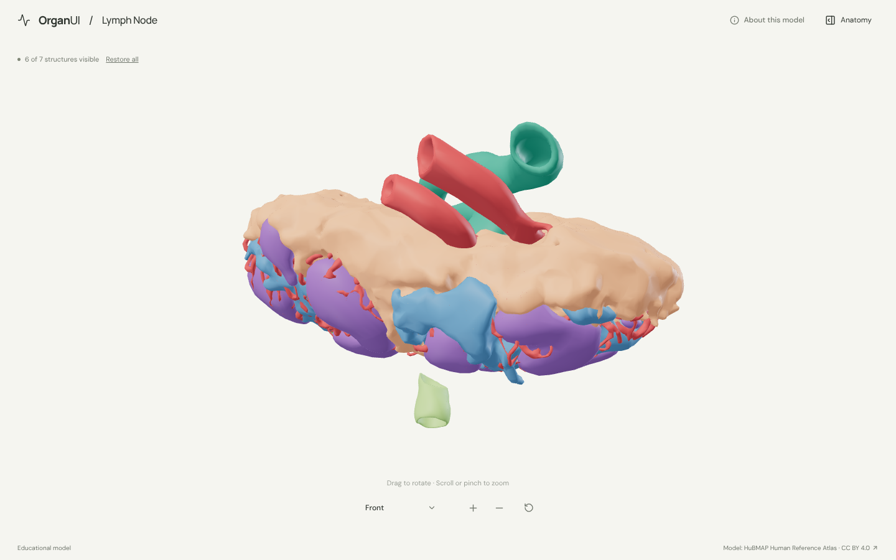
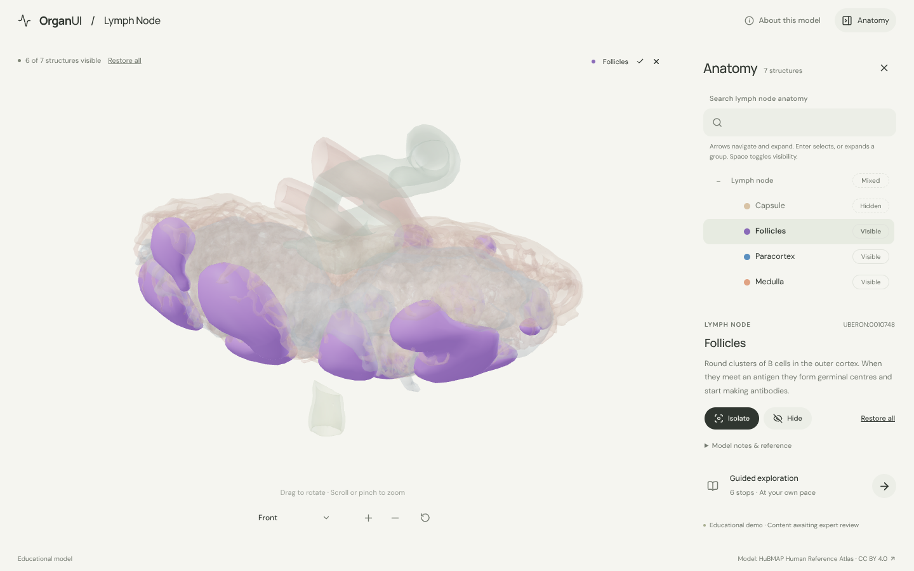
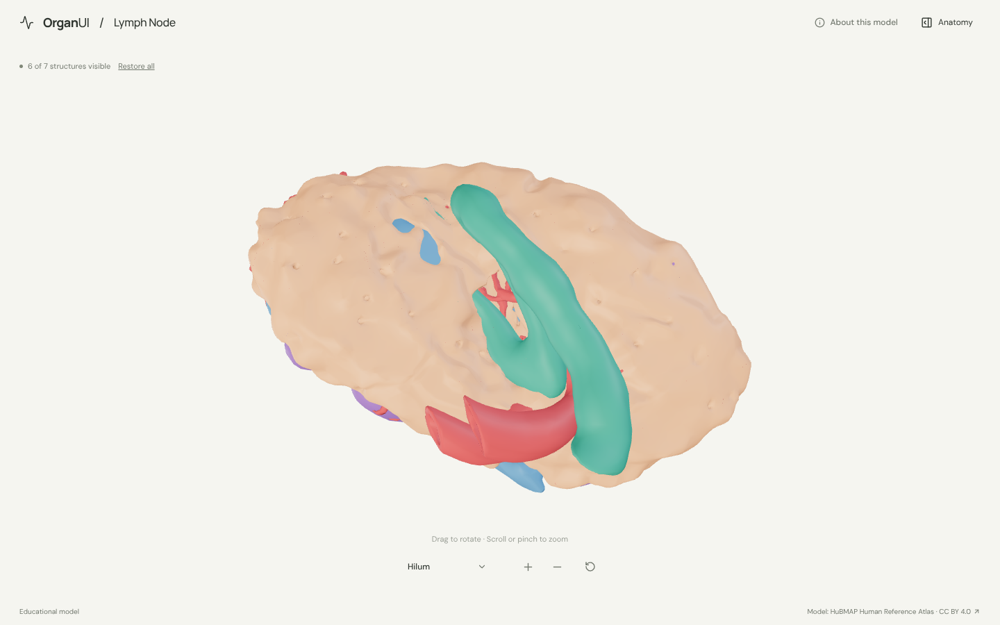
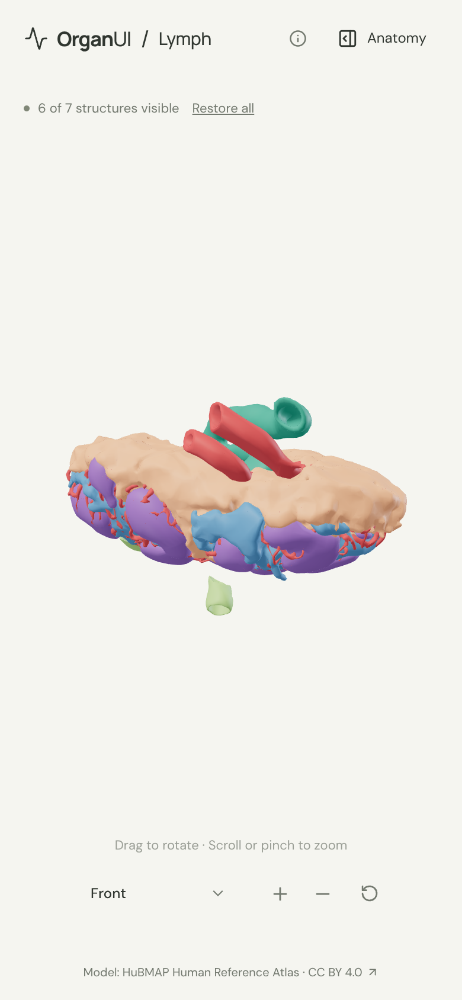

# OrganUI Lymph Node

A minimal, standalone, open-source explorer of a lymph node (capsule, follicles, paracortex, medulla, lymphatic and blood vessels) built with React, TypeScript, Three.js, React Three Fiber, Vite, and Bun. It shares its interaction design and code with [OrganUI Heart](https://github.com/organui/heart-3d).

**Status:** working local demo. Seven selectable structures from a real, openly licensed model, responsive layouts, and checked desktop/mobile interactions. Public deployment and clinical anatomy review have not been completed.



## Run locally

Install [Bun](https://bun.sh/) **1.4.2 or newer**, then:

```sh
git clone https://github.com/organui/lymph-3d.git
cd lymph-3d
bun install --frozen-lockfile
bun run dev
```

Open **http://127.0.0.1:5173**. No environment variables, accounts, API keys, sibling repositories, model downloads, or external font services are needed after dependency installation. The ready-to-use 5.8 MB GLB is in `public/models/`.

```sh
bun run typecheck       # TypeScript checks, including conversion scripts
bun run test            # Unit tests for selection emphasis, picking, ownership, starting state and the anatomy-tree adapter
bun run verify:model    # Check the GLB hash, structure IDs, source nodes, and valid geometry
bun run build           # Typecheck and create dist/
bun run preview         # Serve the production build at http://127.0.0.1:4173
bun run format:check    # Check formatting
```

The app is static and uses relative build paths. No deployment has been performed.

## Explore

- The node opens in the front view with the capsule hidden, so the follicles, paracortex and medulla are visible. The hilum, where the blood vessels and the efferent lymphatic vessel attach, is at the top; the afferent vessel enters from below. **Restore all** or the anatomy panel shows the capsule. Open **Anatomy** in the header to browse structures.
- Drag to rotate; scroll or pinch to zoom. The view menu has front, hilum and side presets. Manual rotation changes its label to **Custom view**; zooming and selecting keep the view name.
- Select a mesh or use the anatomy tree (the OrganUI registry `anatomy-tree` component, see [registry integration](docs/REGISTRY_INTEGRATION.md)). The selected structure glows in its own colour and everything else is ghosted, so the follicles and the efferent vessel stay visible through surrounding tissue.
- Isolate a structure, hide it, or restore all. **Reset explorer** restores the front camera, starting visibility, selection, tree state and tour.
- Follow six guided stops along the path lymph takes: the capsule, the afferent vessel, isolated follicles, the paracortex and medulla from the side, and the efferent vessel at the hilum.
- Keyboard: Tab/Enter for controls, arrow keys to rotate the focused model, `+`/`-` to zoom, Escape closes the panel and returns focus to its toggle.

<details>
<summary>Selection, hilum view and mobile screenshots</summary>







</details>

## Model, credits, and license

> 3D Reference Organ for Lymph Node, Male v1.2, by Kristen Browne and Heidi Schlehlein, HuBMAP Human Reference Atlas 3D Reference Object Library (HuBMAP, NIH award OT2OD026671), licensed under CC BY 4.0. Adapted by OrganUI.

BodyParts3D, which most of the other explorers use, has no lymph nodes or lymphatic vessels, so this explorer uses the HRA reference lymph node: all 7 named mesh nodes of one source file, one structure each. The atlas made the model with cleared-tissue 3D imaging from a research study; its release page notes that node size and cell make-up differ between species but the overall anatomy is well conserved, so it is presented as a general lymph node. The model data and screenshots of it are under **[CC BY 4.0](https://creativecommons.org/licenses/by/4.0/)**, separately from this repository's **MIT code license**. The file comes from a checksum-pinned commit of the atlas's GitHub library, and every node is cross-checked against the atlas's ASCT+B to 3D crosswalk. Read [model provenance](docs/MODEL_PROVENANCE.md), [asset attribution](public/models/ATTRIBUTION.md) and the [manifest](public/models/manifest.json).

Descriptions summarise general anatomy and the [NCI SEER Training lymph nodes page](https://training.seer.cancer.gov/anatomy/lymphatic/components/nodes.html). **Expert anatomical review is pending.** This is an educational interface demonstration, not a diagnostic or clinical tool.

Known limitations:

- One node is shown, enlarged. The body's chains of nodes, lymphatic trunks and thoracic duct are not in either open model source, so there is no whole-body lymphatic map.
- There are no separate meshes for the sinuses, outer cortex or germinal centres; the cortex is shown as its follicles and paracortex.
- The crosswalk labels the source's blood vasculature node as lymph vasculature; it is shown as blood vessels, following the source name and shape.
- Colours are illustrative.
- Browser checks used headless Chromium with software WebGL at desktop and phone viewport sizes, not physical devices or a screen-reader audit.

## License

Original application code: [MIT](LICENSE). Anatomy model, derived model images, fonts, and icons retain their separately documented licenses.

Part of [OrganUI](https://github.com/organui).
